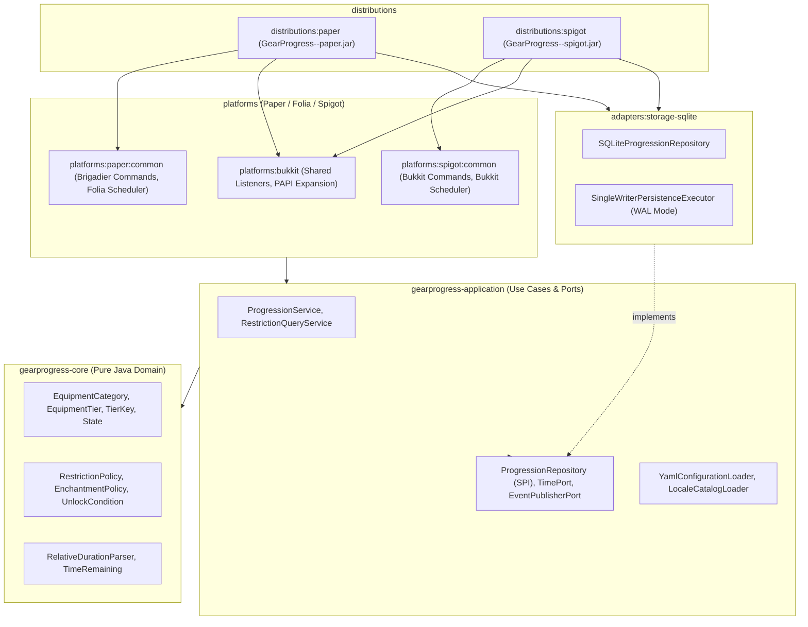

# Architecture Context — GearProgress

## Architectural Pattern
GearProgress is structured strictly according to **Hexagonal Architecture** (Ports and Adapters).

## Module Isolation Invariants
1. `gearprogress-core`: Zero external dependencies, pure Java 21, no server APIs.
2. `gearprogress-application`: Depends only on `core`, defines SPI ports, zero server APIs.
3. `adapters:storage-sqlite`: Implements `ProgressionRepository` using SQLite JDBC and WAL mode.
4. `platforms:bukkit`: Shared Minecraft logic depending on Bukkit API and Adventure.
5. `platforms:paper` & `platforms:spigot`: Platform-specific execution layers.
6. `distributions`: Assembles shaded release JARs with relocation and manifest packaging.
