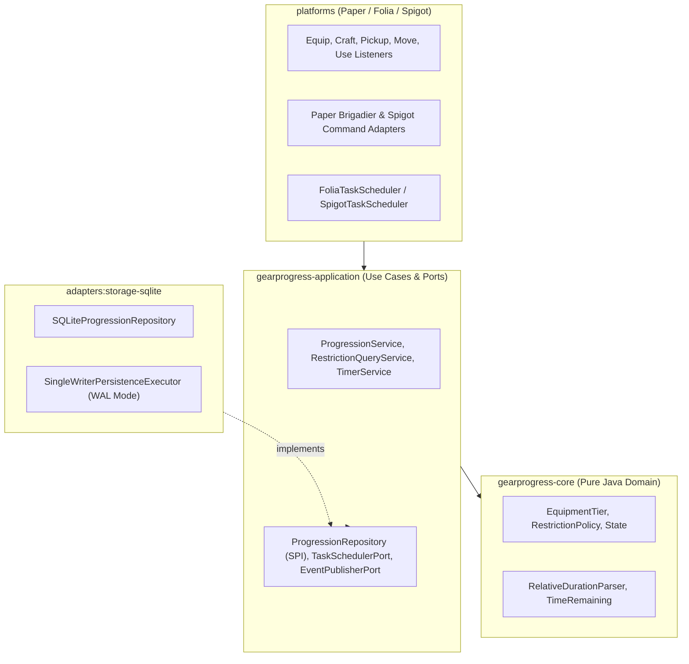

# ⚔️ GearProgress

[](https://github.com/kizio806/GearProgress/actions/workflows/ci.yml)
[](https://sonarcloud.io/summary/new_code?id=kizio806_GearProgress)
[](https://codecov.io/gh/kizio806/GearProgress)
[](https://github.com/kizio806/GearProgress/releases)
[](LICENSE)
[](https://adoptium.net)
[](https://papermc.io/)
[](https://purpurmc.org/)
[](https://papermc.io/software/folia)
[](https://www.spigotmc.org/)

**GearProgress** is a high-performance, enterprise-grade progressive equipment unlocking engine for modern Minecraft servers. Engineered from the ground up for modern **Paper**, **Purpur**, **Folia**, and **Spigot** networks running Minecraft **1.21.x**, GearProgress empowers server administrators to pace SMP seasons, RPG progression, and competitive gameplay by gating armor, tools, weapons, shields, and elytra behind configurable timers, dates, advancements, or manual administrator commands.

---

## 📖 Table of Contents

- [Features](#features)
- [Architectural Highlights](#architectural-highlights)
- [Supported Platforms & Distributions](#supported-platforms--distributions)
- [Installation & Quick Start](#installation--quick-start)
- [Configuration Presets](#configuration-presets)
- [Commands & Permissions](#commands--permissions)
- [PlaceholderAPI Integration](#placeholderapi-integration)
- [Building from Source](#building-from-source)
- [Documentation & Wiki](#documentation--wiki)
- [License](#license)

---

## ✨ Features

- 🛡️ **Comprehensive Equipment Coverage:** Granular gating across Armor (Leather, Chainmail, Iron, Diamond, Netherite), Tools (Wooden through Netherite Axes, Pickaxes, Shovels, Hoes), Weapons (Swords, Bows, Crossbows, Tridents, Maces), Shields, and Elytra.
- 🕒 **Flexible Unlock Mechanisms:** Gate equipment using `always`, `never`, `timer` (relative duration syntax e.g. `14d`, `2w`, `3h30m`), `date` (exact ISO-8601 calendar timestamps), or admin `command`.
- 🔒 **Granular Action Restrictions:** Independently toggle restrictions per tier:
  - `craft`: Prevents crafting recipes on crafting tables and inventory grids.
  - `use`: Prevents swinging, attacking, and tool block-breaking interactions.
  - `equip`: Blocks equipping via right-click, shift-click, drag-and-drop, hotbar key swap, or dispensers.
  - `pickup`: Prevents vacuuming up locked items dropped on the ground.
  - `inventory-move`: Prevents moving locked items between containers and player inventories.
- 🔮 **Tier-by-Tier Enchantment Gating:** Allow basic gear early while delaying overpowered enchantments (e.g. Diamond tier usable on Day 3, but enchantments blocked until Day 7).
- ⚡ **Native Folia Regional Threading:** Thread-safe execution using Folia's `RegionTaskScheduler` and `GlobalRegionScheduler` with zero static singletons or main-thread stalls.
- 💾 **Asynchronous SQLite WAL Persistence:** Database write operations are serialized on a dedicated background thread (`SingleWriterPersistenceExecutor`) with Write-Ahead Logging (`WAL`), eliminating `SQLITE_BUSY` errors.
- 🎨 **Adventure MiniMessage Localization:** Ships with native English (`en-US`) and Polish (`pl-PL`) message bundles, featuring modern colors, gradients, and hover tooltips.
- 📊 **PlaceholderAPI & Interactive GUI:** Exposes comprehensive progression placeholders and includes an interactive chest GUI overview (`/gearprogress gui`).

---

## 🏛️ Architectural Highlights

GearProgress adheres strictly to **Hexagonal Architecture (Ports and Adapters)**:



- **`gearprogress-core`:** Pure Java 21 domain entities, calculation models, and invariant rules. Zero dependencies on Bukkit, Paper, Spigot, or NMS.
- **`gearprogress-application`:** Use cases, configuration parsers, YAML compiler, validation diagnostics, and SPI port definitions.
- **`adapters:storage-sqlite`:** Asynchronous single-writer SQLite persistence implementing application ports.
- **`platforms/`:** Platform adapters bridging Paper and Spigot server runtimes with the domain layer.
- **`distributions/`:** Shaded production deployment artifacts.

Dependency flow is strictly unidirectional: `platform -> application -> core`.

---

## 📦 Supported Platforms & Distributions

GearProgress targets **Java 21 (LTS)** for server execution, governed by our synchronized [Release Management & Versioning Policy](docs/releases.md). We produce two distinct distribution artifacts per release:

| Distribution JAR | Target Server Families | Minecraft Compatibility | Notes |
| :--- | :--- | :---: | :--- |
| **`gearprogress-<base>-<range>-paper-purpur-folia.jar`** | **Paper**, **Purpur**, **Folia** | **1.21 – 1.21.11** (`mc1.21.x`) | Native Brigadier command trees, Folia regional scheduling via `RegionTaskScheduler`, native Adventure MiniMessage, and async chunk loading. |
| **`gearprogress-<base>-<range>-spigot-bukkit.jar`** | **Spigot**, **CraftBukkit** | **1.21 – 1.21.11** (`mc1.21.x`) | Dedicated BukkitScheduler tasks, classic Bukkit command routing, tab completion, and relocated Adventure BukkitAudiences. |

> [!IMPORTANT]
> Install **exactly one** matching JAR in your server's `plugins/` directory.

---

## 📥 Installation & Quick Start

### 1. Prerequisites
- Minecraft server running **Paper 1.21.x**, **Purpur 1.21.x**, **Folia 1.21.x**, or **Spigot 1.21.x**.
- **Java 21 runtime** or higher (`java -version`).
- *(Optional)* [PlaceholderAPI](https://placeholderapi.com/) for scoreboard and tab list integration.

### 2. First Installation
1. Download the distribution JAR corresponding to your server platform from [GitHub Releases](https://github.com/kizio806/GearProgress/releases).
2. Place the JAR into your server's `plugins/` directory.
3. Start the server. GearProgress will generate default configurations:
   ```text
   plugins/GearProgress/
   ├── config.yml              # Primary server configuration & check intervals
   ├── equipment.yml           # Equipment tier definitions & restriction flags
   ├── timers.yml              # Server epoch timestamps & timer overrides
   ├── storage.yml             # SQLite database configuration
   ├── gearprogress.db         # Persistent progression database (WAL mode)
   └── locales/                # Language message catalogs (en-US.yml, pl-PL.yml)
   ```
4. Customize your season timeline in `equipment.yml` and `timers.yml`.
5. Run `/gearprogress reload` to apply configuration changes without restarting.

---

## ⚙️ Configuration Presets

### 14-Day SMP Season Preset
A balanced SMP schedule pacing player progression:
- **Days 1–3:** Leather, Chainmail, and Iron unrestricted; Diamond craft allowed, but Diamond armor equip/use locked until Day 3.
- **Days 3–7:** Diamond equipment fully unlocked; Netherite locked until Day 14.
- **Day 14:** Netherite equipment unlocked.

```yaml
# plugins/GearProgress/equipment.yml
armor:
  diamond:
    unlock:
      type: timer
      after: 3d
    restrictions:
      equip: true
      use: true
    enchantments:
      allow-enchanted: false
  netherite:
    unlock:
      type: timer
      after: 14d
    restrictions:
      craft: true
      equip: true
      use: true
      pickup: true
      inventory-move: true
```

---

## 🎮 Commands & Permissions

| Command | Description | Permission | Default |
| :--- | :--- | :--- | :---: |
| `/gearprogress info [cat] [tier]` | Inspect progression status and countdowns | `gearprogress.info` | Everyone |
| `/gearprogress gui` | Open interactive visual progression overview | `gearprogress.gui` | Everyone |
| `/gearprogress unlock <cat> <tier>` | Manually unlock a tier immediately | `gearprogress.admin` | OP |
| `/gearprogress lock <cat> <tier>` | Manually lock a tier | `gearprogress.admin` | OP |
| `/gearprogress reset <cat> <tier>` | Reset a tier to initial configuration state | `gearprogress.admin` | OP |
| `/gearprogress timer pause <cat> <tier>` | Pause a countdown timer | `gearprogress.admin` | OP |
| `/gearprogress timer resume <cat> <tier>` | Resume a paused timer | `gearprogress.admin` | OP |
| `/gearprogress timer add <cat> <tier> <dur>` | Add duration to a timer (e.g. `2d`) | `gearprogress.admin` | OP |
| `/gearprogress timer set <cat> <tier> <dur>` | Set exact remaining duration | `gearprogress.admin` | OP |
| `/gearprogress reload` | Reload configuration and locale files | `gearprogress.admin` | OP |

**Special Permissions:**
- `gearprogress.bypass`: Completely bypasses all equipment and enchantment restrictions.
- `gearprogress.admin`: Wildcard administrative permission for all subcommands.

---

## 🔌 PlaceholderAPI Integration

| Placeholder | Description | Example Output |
| :--- | :--- | :--- |
| `%gearprogress_current_stage_<category>%` | Currently active tier in category | `diamond` |
| `%gearprogress_next_unlock_<category>%` | Next locked tier in category | `netherite` |
| `%gearprogress_time_remaining_<cat>_<tier>%` | Formatted countdown to unlock | `3d 14h 22m` |
| `%gearprogress_is_unlocked_<cat>_<tier>%` | Whether tier is unlocked | `true` / `false` |
| `%gearprogress_status_<cat>_<tier>%` | Progression state | `UNLOCKED`, `LOCKED`, `PAUSED` |

---

## 🛠️ Building from Source

### Prerequisites
- JDK 21 or higher (Eclipse Temurin recommended)
- Git & Bash

### Build & Verification Commands

```bash
# Clone the repository
git clone https://github.com/kizio806/GearProgress.git
cd GearProgress

# Apply Spotless code formatting (Google Java Format)
./gradlew spotlessApply

# Run all tests, static analysis, and quality gates
./gradlew check

# Build production distribution JARs
./gradlew :distributions:paper:build :distributions:spigot:build
```

| Verification Command | Purpose |
| :--- | :--- |
| `./gradlew check` | Runs Spotless, Checkstyle, SpotBugs, PMD, ErrorProne, boundaries, and JaCoCo ($\ge 90\%$). |
| `./scripts/verification/validate-structure.sh` | Validates package layout, module cleanliness, and document links. |
| `./scripts/verification/validate-source-hygiene.sh` | Fails on any `@SuppressWarnings`, wildcard imports, or `TODO` tags. |
| `./scripts/release.sh --dry-run` | Validates release packaging and distribution checksums. |

---

## 📚 Documentation & Governance

- **Technical Documentation:**
  - [Architecture Guide](docs/architecture.md) — Hexagonal design, ports, single-writer persistence, and Folia threading.
  - [Building from Source](docs/building.md) — Toolchains, Gradle tasks, and distribution packaging.
  - [Configuration Reference](docs/configuration.md) — Comprehensive YAML specifications and unlock methods.
  - [Testing Standards](docs/testing.md) — Behavioral testing, MockBukkit, and JaCoCo coverage gates.
  - [Compatibility Matrix](docs/compatibility-matrix.md) — Supported server runtimes and Java baselines.
  - [Installation Guide](docs/installation.md) — Step-by-step setup instructions.
  - [Development Guide](docs/development.md) — Developer environment setup and testing workflows.
  - [Release Process](docs/releases.md) — Distribution packaging, versioning, and publishing steps.
  - [Modrinth Publishing Guide](docs/modrinth.md) — Release metadata and store descriptions.
  - [Troubleshooting Guide](docs/troubleshooting.md) — Diagnostics and common edge case resolution.
  - [Wiki Documentation](docs/wiki/Home.md) — Complete user guide and configuration presets.

- **Governance & Policy:**
  - [Support Policy](SUPPORT.md) — Help channels, bug reports, and version support.
  - [Contributing Guidelines](CONTRIBUTING.md) — Code hygiene, pull request guidelines, and commit standards.
  - [Code of Conduct](CODE_OF_CONDUCT.md) — Community standards and enforcement guidelines.
  - [Security Policy](SECURITY.md) — Vulnerability reporting and credential security.
  - [Changelog](CHANGELOG.md) — Release history and migration notes.
  - [AI Guidelines & Architecture Manual](AGENTS.md) — Authoritative operating instructions for AI assistants.

---

## 📄 License

GearProgress is licensed under the [Mozilla Public License Version 2.0 (MPL-2.0)](LICENSE).
