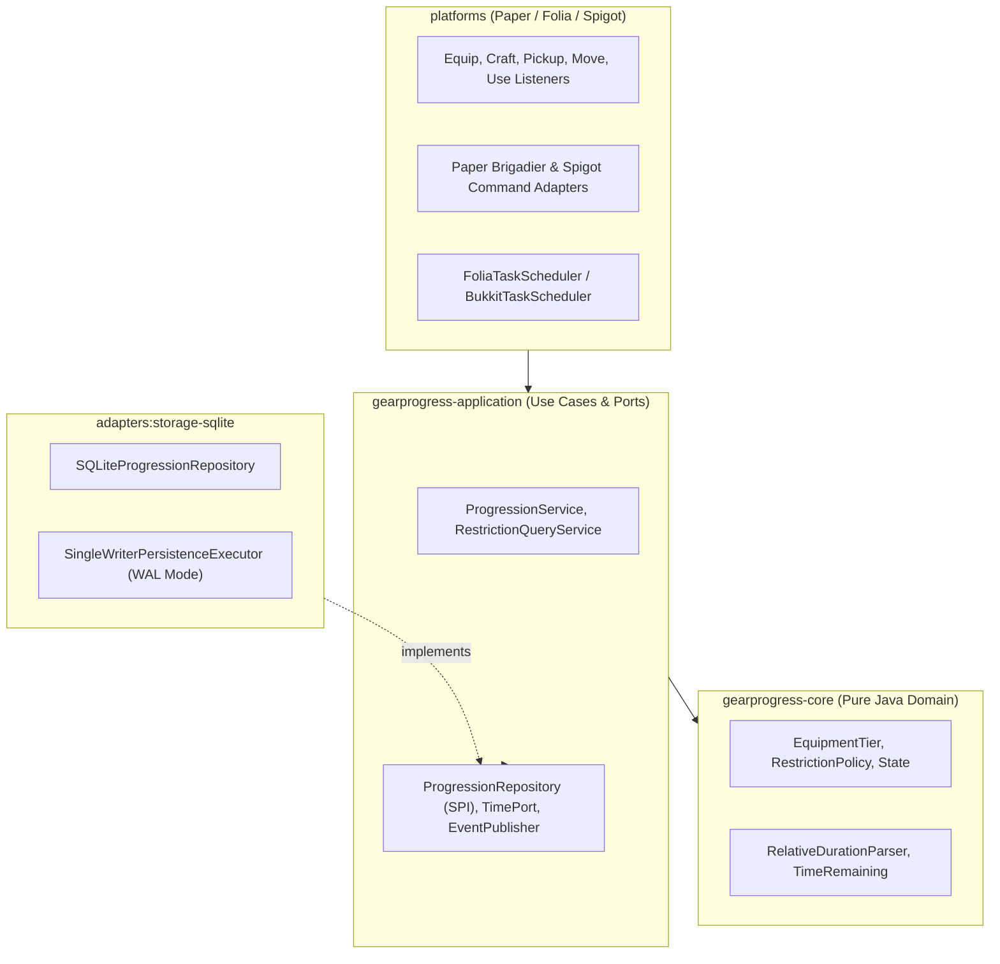

# GearProgress

[](https://github.com/kizio806/GearProgress/actions/workflows/ci.yml)
[](LICENSE)
[](https://adoptium.net)
[](https://www.minecraft.net)

**GearProgress** is a modern, enterprise-grade Minecraft plugin that manages progressive equipment unlocking on SMP servers. It allows server administrators to gate armor, tools, weapons, shields, and elytra behind configurable timers, dates, or manual commands across both **Paper/Purpur/Folia** and **Spigot/CraftBukkit** servers.

## Features
- **Extensive Equipment Support**: Control progression across Armor (Leather, Chainmail, Iron, Diamond, Netherite), Tools, Weapons, Shields, and Elytra.
- **Multiple Unlock Methods**: Gate equipment with `always`, `never`, `timer` (e.g. `after: 7d`), `date` (ISO-8601 timestamps), or admin `command`.
- **Granular Restrictions**: Independently toggle blocking for `craft`, `use`, `equip`, `pickup`, and `inventory move`.
- **Enchantment Control**: Configure whether enchantments are allowed on a tier-by-tier basis (e.g. Diamond tier allowed without enchantments first, then enchantments unlocked later).
- **Dual Platform Support**:
  - Paper, Purpur, and Folia via `gearprogress-<base>-<range>-paper-purpur-folia.jar` (native Brigadier commands & Folia schedulers).
  - Spigot and CraftBukkit via `gearprogress-<base>-<range>-spigot-bukkit.jar` (standard Bukkit commands & relocated Adventure).
- **PlaceholderAPI Integration**: Exposes stage, time remaining, and unlock statuses for scoreboards, tabs, and menus.
- **Adventure MiniMessage Localization**: Ships with English (`en-US`) and Polish (`pl-PL`) catalogs.
- **Clean Hexagonal Architecture**: Engineered with pure Java domain boundaries, single-writer SQLite persistence, and zero singletons.

## Architecture Highlights

GearProgress adheres strictly to Hexagonal Architecture (Ports and Adapters) to ensure zero coupling between domain rules and Minecraft server APIs:



## Quick Configuration Example

Below is a snippet demonstrating how Netherite gear can be locked for the first 14 days of an SMP season, with diamond unlocked from day 3:

```yaml
# plugins/GearProgress/config/equipment.yml
armor:
  diamond:
    unlock:
      type: timer
      after: 3d
    restrictions:
      equip: true
      use: true
  netherite:
    unlock:
      type: timer
      after: 14d
    restrictions:
      craft: true
      equip: true
      use: true
      pickup: true
      inventory-move: true
```

## Documentation & Governance
- [Architecture Guide](docs/architecture.md)
- [Compatibility Matrix](docs/compatibility-matrix.md)
- [Installation Guide](docs/installation.md)
- [Development Guide](docs/development.md)
- [Release Process](docs/releases.md)
- [Troubleshooting](docs/troubleshooting.md)
- [Wiki Documentation](docs/wiki/Home.md)
- [Roadmap](ROADMAP.md)
- [Support Policy](SUPPORT.md)
- [Contributing Guidelines](CONTRIBUTING.md)
- [Code of Conduct](CODE_OF_CONDUCT.md)
- [Security Policy](SECURITY.md)
- [Changelog](CHANGELOG.md)
- [AI Guidelines & Architecture Manual](AGENTS.md)

## License
GearProgress is licensed under the [Mozilla Public License Version 2.0 (MPL-2.0)](LICENSE).
