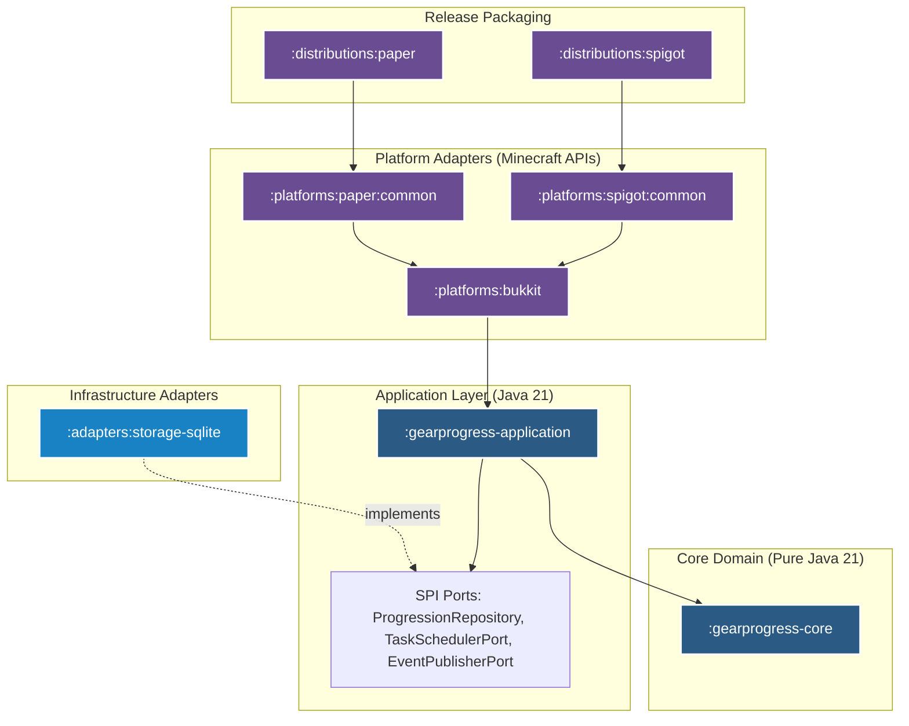

# GearProgress Architecture Manual

This document defines the architectural principles, module boundaries, concurrency models, and domain invariants governing the **GearProgress** codebase.

---

## 🏛️ System Overview & Philosophy

GearProgress is engineered around **Hexagonal Architecture (Ports and Adapters)**. The design guarantees:
1. **Zero Minecraft Coupling in Domain Rules:** Core domain models and business orchestration are completely agnostic of Minecraft server internals, Bukkit, Paper, or NMS.
2. **Deterministic Thread Safety:** Multi-threaded Folia environments and asynchronous timer evaluations never trigger data races or concurrent database write contention.
3. **Pluggable Persistence:** Storage backends implement clean SPI ports, isolated behind single-writer executors.
4. **Dual Platform Releases:** High-performance Paper/Folia Brigadier and asynchronous chunk routing alongside clean Spigot/CraftBukkit compatibility.

---

## 📐 Module Hierarchy & Topology



---

## 📦 Module Responsibilities

### 1. `gearprogress-core` (Pure Java 21 Domain)
- **Role:** Pure domain entity definitions, value objects, mathematical calculations, and invariant validation.
- **Key Types:**
  - `EquipmentCategory`: Enum classifying gear slots (`ARMOR`, `TOOLS`, `WEAPONS`, `SHIELD`, `ELYTRA`).
  - `EquipmentTier`: Tier identifier (`leather`, `iron`, `diamond`, `netherite`, etc.).
  - `TierKey`: Composite value object `(category, tier)`.
  - `UnlockCondition`: Sealed interface modeling unlock mechanisms (`Always`, `Never`, `Timer`, `Date`, `Command`).
  - `RestrictionPolicy`: Bitwise / immutable mapping of blocked actions (`CRAFT`, `USE`, `EQUIP`, `PICKUP`, `INVENTORY_MOVE`).
  - `EnchantmentPolicy`: Governs whether enchantments are permitted prior to full tier unlocking.
  - `TierProgressState`: Runtime state of a tier (`LOCKED`, `UNLOCKED`, `PAUSED`).
  - `RelativeDurationParser`: Deterministic string duration parser (`14d`, `2w`, `3h30m`, `45s`).
- **Dependencies:** Standard Java 21 runtime only. Zero external dependencies.

### 2. `gearprogress-application` (Orchestration & Use Cases)
- **Role:** Business logic orchestration, timer polling, configuration parsing, YAML compilers, and SPI ports.
- **Key Services:**
  - `ProgressionService`: Controls unlocking, locking, and status queries.
  - `TimerService`: Evaluates relative duration elapsed times and schedules periodic checks.
  - `RestrictionQueryService`: High-performance read-only query service consumed by platform event listeners to determine action blockage.
  - `EquipmentDefinitionCompiler`: Validates and compiles YAML specifications into validated domain definitions.
  - `YamlConfigLoader`: Handles structured loading, fallback parsing, and error diagnostics.
  - `LocaleCatalog`: Adventure MiniMessage translation dictionary with placeholder substitution.
- **Ports (SPI):**
  - `ProgressionRepository`: Asynchronous database read/write interface.
  - `TaskSchedulerPort`: Abstraction for periodic and async task execution across Folia and Bukkit.
  - `EventPublisherPort`: Abstraction for broadcasting progression unlock events.
  - `LifecycleReporterPort`: Logging and telemetry reporting port.
  - `TimePort`: System clock abstraction enabling deterministic unit testing.

### 3. `adapters:storage-sqlite` (Persistence Adapter)
- **Role:** Asynchronous SQLite database management and repository implementation.
- **Features:**
  - `SingleWriterPersistenceExecutor`: Dedicated single-threaded executor guaranteeing that all SQLite write transactions are sequentially executed on one background thread, completely eliminating `SQLITE_BUSY` contention.
  - **WAL Mode (`PRAGMA journal_mode=WAL;`):** Write-Ahead Logging allows concurrent, non-blocking reads while writes are staged.
  - **Schema Migrations:** Automated schema creation and versioned migrations.

### 4. `platforms:bukkit` (Shared Bukkit Layer)
- **Role:** Server event listeners, item classification, GUI menus, and audience messaging.
- **Listeners:**
  - `CraftRestrictionListener`: Blocks crafting recipes for locked tiers (`PrepareItemCraftEvent`, `CraftItemEvent`).
  - `UseRestrictionListener`: Prevents block interaction, attacking, and tool use with locked items (`PlayerInteractEvent`, `EntityDamageByEntityEvent`).
  - `EquipRestrictionListener`: Prevents equipping locked armor via right-click, shift-click, hotbar swap, dispenser, or drag-and-drop (`PlayerArmorChangeEvent`, `InventoryClickEvent`, `PlayerInteractEvent`).
  - `PickupRestrictionListener`: Cancels picking up locked dropped items (`EntityPickupItemEvent`).
  - `InventoryMoveRestrictionListener`: Prevents moving locked items between containers (`InventoryMoveItemEvent`, `InventoryClickEvent`).
  - `EnchantmentRestrictionListener`: Blocks enchanting items that violate the tier's enchantment policy (`PrepareItemEnchantEvent`, `EnchantItemEvent`, `PrepareAnvilEvent`).
- **Features:**
  - `ProgressionGuiView` & `ProgressionGuiListener`: Interactive virtual inventory view displaying unlock progress and countdowns.
  - `GearProgressPlaceholderExpansion`: PlaceholderAPI bridge (`%gearprogress_status_<cat>_<tier>%`, etc.).

### 5. `platforms:paper:common` & `platforms:spigot:common`
- **Paper Adapter:** Paper/Purpur/Folia runtime entrypoint using native Brigadier commands, Folia regional task schedulers, and Adventure MiniMessage.
- **Spigot Adapter:** Spigot/CraftBukkit entrypoint using Bukkit commands, tab completion, relocated Adventure libraries, and BukkitScheduler.

---

## ⚡ Concurrency & Folia Regional Thread Safety

Folia splits the traditional single Minecraft main thread into hundreds of independent, regional tick threads. GearProgress adheres to strict concurrency guidelines:

```
[Minecraft Region Thread A] ──┐
                              ├──> RestrictionQueryService (Thread-Safe Reads / In-Memory State)
[Minecraft Region Thread B] ──┘
                                             │
                                     State Mutation Event
                                             │
                                             ▼
                             ProgressionService.unlock()
                                             │
                                             ▼
                             SingleWriterPersistenceExecutor
                                             │
                                   [Dedicated Writer Thread]
                                             │
                                             ▼
                                  SQLite WAL Transaction
```

1. **Lock-Free Restriction Evaluation:** In-game player events (crafting, equipping, attacking) query `RestrictionQueryService` using concurrent, thread-safe memory reads (`ConcurrentHashMap` and immutable data classes). Zero locks or blocking I/O on the tick threads.
2. **Serialized Background Persistence:** All state modifications are dispatched asynchronously to the `SingleWriterPersistenceExecutor`, guaranteeing sequential write ordering and WAL concurrency.
3. **Graceful Queue Draining:** Upon server shutdown (`/stop`), the executor blocks until all pending write operations are committed to disk before terminating the connection.
